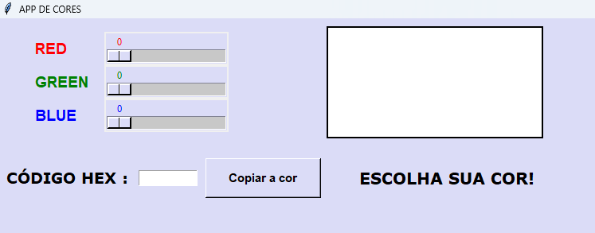

## 🎨 ESCOLHA SUA COR!

Seletor de cores desenvolvido em **Python**, com interface gráfica **Tkinter**, para a 4ª Avaliação da disciplina de Lógica, Algoritmos e Programação.

## 👥 Dupla

- [Luis Felipe](https://github.com/fellypekrt77)
- [Deylane Moura](https://github.com/delaynemouraIT)

## 🎯 O que o app faz?

O aplicativo permite misturar os canais Vermelho (Red), Verde (Green) e Azul (Blue) por meio de controles deslizantes, criando cores em tempo real. Ele também exibe o código hexadecimal da cor selecionada e permite copiá-lo para a área de transferência.

## ⚙️ Funcionalidades

- Controle dos três canais RGB, com valores de 0 a 255.
- Visualização da cor em tempo real.
- Geração do código hexadecimal correspondente.
- Botão para copiar o código hexadecimal, com mensagem de confirmação.

## 🛠️ Tecnologias utilizadas

- **Python 3** — linguagem de programação.
- **Tkinter** — criação da interface gráfica.
- **Git e GitHub** — controle de versões e compartilhamento do projeto.

## 🖥️ Como ficou



*Tela inicial do seletor de cores.*

## 🚀 Como rodar o projeto

É necessário ter o Python 3 instalado com a biblioteca Tkinter, normalmente incluída na instalação do Python no Windows. Não são necessárias bibliotecas externas do Python.

### 1. Clone o repositório

```bash
git clone https://github.com/fellypekrt77/ESCOLHA-SUA-COR.git
```

### 2. Acesse a pasta do projeto

```bash
cd ESCOLHA-SUA-COR
```

### 3. Execute o aplicativo

```bash
python "app de cores.py"
```

